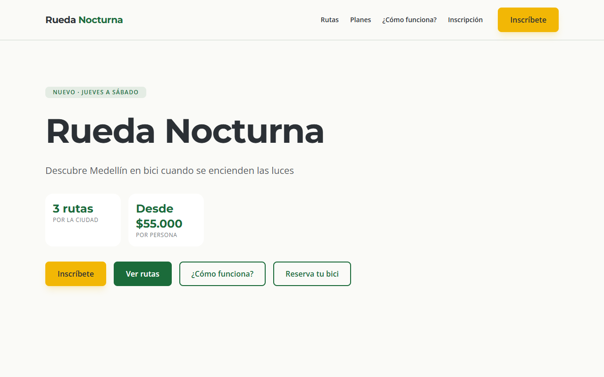
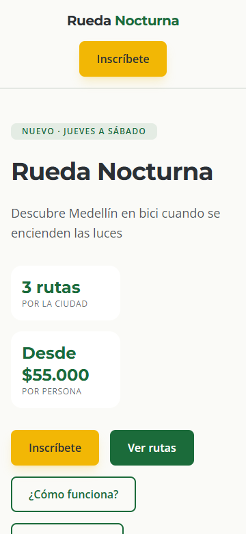
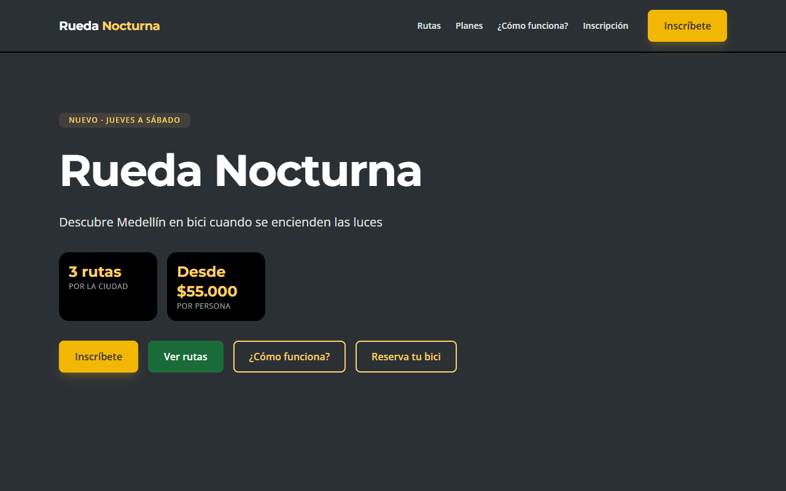
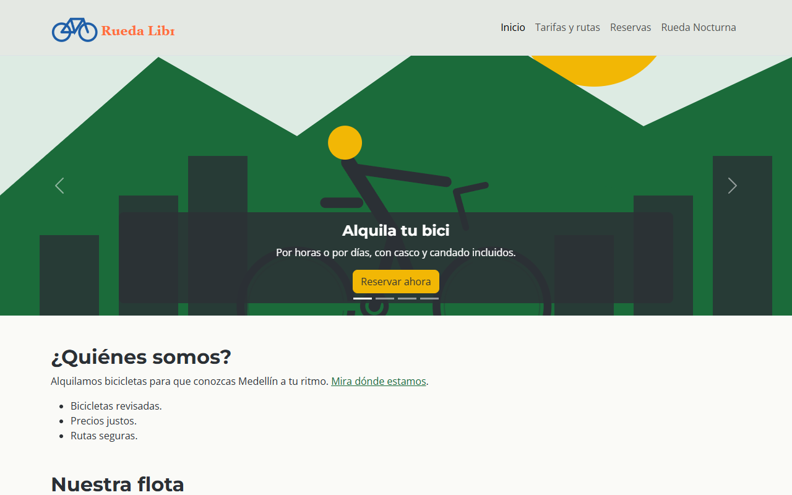

# Ecosistema Rueda Libre — sitio v2.0 + Rueda Nocturna

Rueda Libre alquila bicicletas en Medellín. Este proyecto junta dos productos enlazados entre sí:

- **Sitio Rueda Libre v2.0** (Bootstrap 5.3): inicio con carrusel, tarifas y rutas, y reservas.
- **Landing Rueda Nocturna** (Tailwind CSS 4): campaña de recorridos en bici de noche, de jueves a sábado. Tiene rutas, planes, cómo funciona e inscripción.

## Enlaces publicados

- Sitio: https://samintone2106.github.io/html-semana-3/dia-3/reto-12-lanzamiento/
- Landing: https://samintone2106.github.io/html-semana-3/dia-3/reto-12-lanzamiento/nocturna/
- Kit de componentes: https://samintone2106.github.io/html-semana-3/dia-3/reto-12-lanzamiento/nocturna/componentes.html

## Páginas

| Página | Archivo | Qué tiene |
|---|---|---|
| Inicio | `index.html` | Navbar, carrusel de 4 diapositivas (la 4.ª lleva a Rueda Nocturna), flota, rutas |
| Tarifas y rutas | `paginas/tarifas.html` | Tablas de alquiler y recorridos |
| Reservas | `paginas/reservas.html` | Formulario de reserva validado |
| Rueda Nocturna | `nocturna/index.html` | Portada, rutas, planes, cómo funciona e inscripción |
| Kit | `nocturna/componentes.html` | Botones, card, alertas y campos |

## Tecnologías

- HTML semántico y formularios con validación nativa (`required`, `minlength`, `pattern`, `min`, `max`).
- Bootstrap 5.3.3 (CDN) con la marca en variables `--bs-*`.
- Tailwind CSS 4 con la CLI (`@tailwindcss/cli`): `@theme` para la marca, `dark:` para el modo oscuro, `@apply` en 3 clases de botón y `output.css` minificado.
- Google Fonts: Montserrat (títulos) y Open Sans (texto).

**Marca (mismos valores en los dos productos):** Verde Ruta `#1B6B3A`, Gris Asfalto `#2B3035`, Amarillo Señal `#F2B705`, Gris Niebla `#E4E8E3`, Fondo `#FAFAF7` y Amarillo Farol `#FFD166` (color de la campaña).

## Cómo correrlo

```bash
cd dia-3/reto-12-lanzamiento/nocturna
npm install                      # instala Tailwind (node_modules no se sube)
npm run dev                      # observa cambios
npm run build                    # genera src/output.css minificado
```
Abre `index.html` con Live Server. `output.css` ya está subido, así que GitHub Pages no necesita la CLI.

## Recomendación de framework (MiniReto 8)

| Criterio | Bootstrap | Tailwind |
|---|---|---|
| Curva de aprendizaje | Más fácil al inicio | Pide saber CSS, luego es más rápido |
| Personalización | Hay que pisar muchas variables `--bs-*` | `@theme` genera todas las utilidades de marca |
| Tamaño final | 313.5 KB (54.8 KB comprimido) CSS + JS | 29 KB (5 KB comprimido) |
| Casos de uso | Paneles y prototipos con componentes listos | Sitios con diseño de marca propio y carga rápida |

**Recomendación:** que la próxima versión de todo el sitio de Rueda Libre quede en **Tailwind**. La marca se define una vez, la página carga unas 10 veces menos (casi todo el tráfico llega desde el celular) y el kit de componentes ya está hecho.

## Capturas

| Escritorio | Celular (360 px) | Modo oscuro |
|---|---|---|
|  |  |  |



## Lista de verificación

- [x] Estructura semántica: `header`, `main`, `section` con `id`, `footer`, y un solo `h1` por página.
- [x] Accesibilidad: todas las imágenes tienen `alt`, todos los campos tienen `label`, el foco se ve en todo lo que se usa con teclado y el contraste es ≥ 4.5:1.
- [x] Formularios validados (inscripción y reservas).
- [x] Responsive a 360, 768, 1024 y 1280 px sin scroll horizontal.
- [x] Modo claro y oscuro en la landing.
- [x] 0 enlaces o recursos con 404 (revisados 45 enlaces y recursos locales).
- [x] Sin `style=""` ni `<style>`. `output.css` minificado y subido.
- [x] Validador W3C: 0 errores en la landing, reservas, inicio, tarifas y kit.

## Aprendizajes

- Utility-first: armar un botón con utilidades da control total, y con `@apply` se puede ordenar sin perder ese control.
- Mobile-first: lo que no lleva prefijo es para el celular. `sm:`, `md:` y `lg:` agregan cosas a partir de cierto ancho.
- El contraste se mide, no se adivina: Verde Ruta sobre Gris Asfalto parecía bien y daba 2.04:1.
- Un kit con reglas fijas (radios, espaciado y colores) hace que la landing "se arme sola".

## Autor

AlexanderKast — Riwi, módulo HTML y CSS, semana 3.
